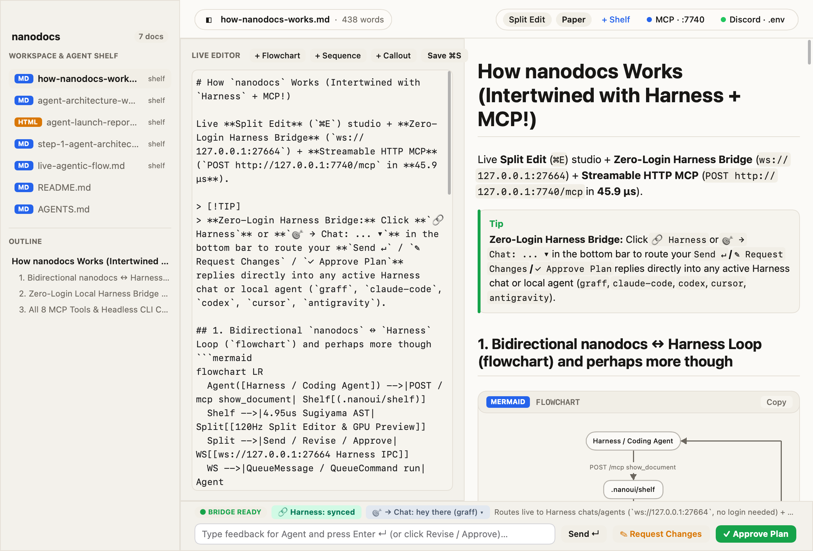
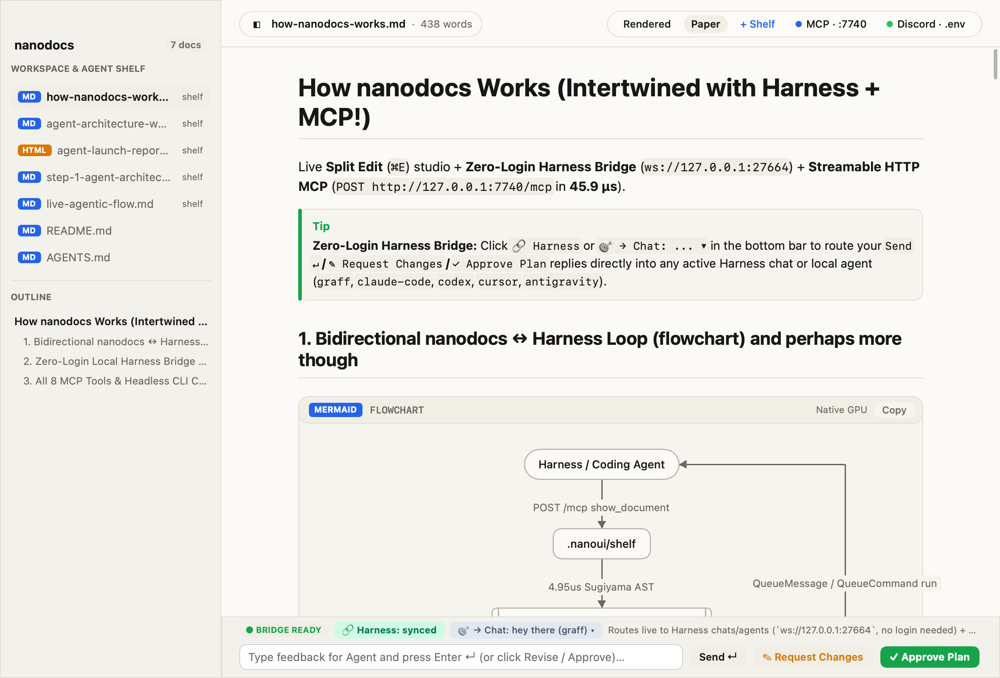
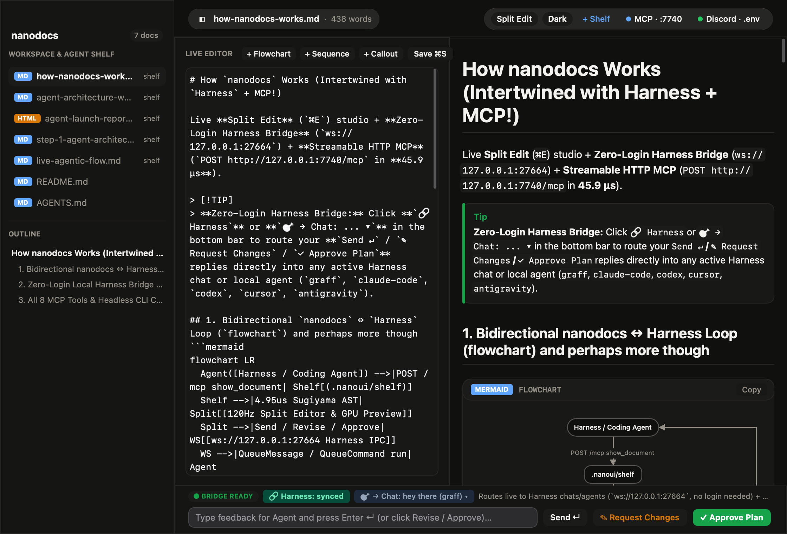

# nanodocs

**Native 120 Hz GPU Markdown, HTML & Mermaid Studio + Bidirectional Agent & Harness Bridge**, built in Zig 0.17 on [`nanoui`](https://github.com/justrach/nanoui).

Zero webviews, zero Electron, zero per-frame parsing: documents and Mermaid diagrams are pre-parsed into typed ASTs in **4.95 µs** and drawn directly with Metal and CoreText on macOS (or `nanoui`'s TrueType shaper and OpenGL / D3D11 / CPU renderer on Linux and Windows).



---

## Screenshots

| Editorial Paper Mode (`Rendered`) | Obsidian Dark Mode (`Split Edit · --dark`) |
| --- | --- |
|  |  |

---

## Why `nanodocs`?

Coding agents generate Markdown plans, architecture walkthroughs, and Mermaid diagrams constantly—and need human edits, approvals, or change requests back without copy-pasting walls of text.

`nanodocs` turns agent walkthroughs into an **instant, interactive 120 Hz native loop**:

1. **Agents push visual walkthroughs in 45.9 µs** over Streamable HTTP MCP (`POST http://127.0.0.1:7740/mcp`) or CLI (`nanodocs show --split`).
2. **Humans edit Markdown & Mermaid live (`⌘E`)**: every keystroke re-parses the AST in a 4-slot arena ring (`~10 µs`) and updates the 120 Hz Metal GPU diagram on the right with zero flicker.
3. **1-Click Feedback Routes Back to Your Agent (`Send ↵` / `✎ Request Changes` / `✓ Approve Plan`)**:
   - **Direct `Harness` Bridge (`ws://127.0.0.1:27664`, Zero Login Required)**: pushes your review and live document path directly into any active Harness chat (`QueueMessage` / `QueueCommand: run`) or spawns a new local agent chat (`graff`, `claude-code`, `codex`, `cursor`, `antigravity`, `grok`, `pi`, `opencode`).
   - **Reactive MCP & CLI Wakeup (`wait_for_feedback` / `nanodocs wait`)**: lights up the purple **`⚡ AGENT WAITING`** indicator in the window and unblocks the waiting agent the millisecond you click Send or Approve.

---

## Performance (`nanodocs --bench`, Apple Silicon `ReleaseFast`)

| Stage | Latency | Notes |
| --- | --- | --- |
| **Mermaid AST + Sugiyama Layout Pre-Parse** | **4.95 µs** | Ranked Sugiyama + barycenter ordering cached once on load/edit (`0 ms` per frame) |
| **Retained 120 Hz Scroll Frame** | **19.22 µs** | **>52,000 fps** theoretical ceiling via `nanoui` retained scroll skirts (`100/100` hit rate) |
| **Full Window Layout + Paint Frame** | **199.7 µs** | Full sidebar + top glass bar + Markdown + GPU Mermaid (`33×` faster than 120 Hz budget) |
| **MCP `render_mermaid` Roundtrip** | **45.9 µs** | JSON-RPC parse + AST pre-parse + `.nanoui/shelf/` persistence |

---

## Intertwined with `Harness` (Works 100% Without Logging In!)

`nanodocs` includes a native RFC 6455 loopback client (`src/harness_bridge.zig`, `src/harness_ws.zig`) that speaks directly to the local **Harness** engine on `ws://127.0.0.1:27664` (`HARNESS_IPC_PORT`).

- **Zero Cloud Login Needed**: Harness's local engine (`harness headless` / `Harness.app`) runs in **Local Mode (`local-profile.json`)** using your local agent CLIs (`graff`, `claude`, `codex`, `cursor-agent`, `agy`, `pi`, `opencode`).
- **1-Click `🔗 Connect Harness (No Login)`** in the bottom bar (or `nanodocs harness connect`):
  1. Automatically starts `harness headless` in local mode if port `27664` isn't listening yet.
  2. Writes `nanodocs` (`http://127.0.0.1:7740/mcp` + stdio) into `.mcp.json`.
  3. Sends `McpServerAction: {"action": "reconnect", "name": "nanodocs"}` over `ws://127.0.0.1:27664` so every Harness agent immediately discovers `nanodocs`'s 8 MCP tools.
- **Interactive Target Selector (`🎯 → Chat: ... ▾`)**:
  - Click the target pill in the bottom bar to cycle between your **5 most recent active Harness chats** (sorted newest-first) OR **`+ New <agent> chat`** (`+ New graff chat`, `+ New claude-code chat`, `+ New codex chat`, `+ New cursor chat`, etc.).
  - Clicking **`Send ↵`**, **`✎ Request Changes`**, or **`✓ Approve Plan`** sends `QueueMessage` (when busy) or `QueueCommand` (`kind: "run"`) straight into that Harness chat!

```sh
# Inspect local Harness connection, active chats, and installed local agents:
nanodocs harness status

# Auto-start local `harness headless` (no login required), wire .mcp.json & reconnect MCP:
nanodocs harness connect

# Push a review or message straight into the active Harness chat from CLI:
nanodocs harness send --doc architecture-plan.md --status approved --message "Ship it!"
```

---

## Streamable HTTP & Stdio MCP Server (`:7740/mcp`)

Whenever `nanodocs` is open, it automatically serves **Streamable HTTP MCP** at `http://127.0.0.1:7740/mcp` (and supports stdio via `nanodocs mcp`), implementing both stateless `2026-07-28` MCP (`server/discover`, `params._meta`) and session-based `2025-11-25` / `2024-11-05` MCP (`initialize`, `Mcp-Session-Id`).

### All 8 MCP Tools

| Tool | Description |
| --- | --- |
| `show_document` | Saves `.md` or `.html` to `.nanoui/shelf/` & wakes the live GUI (`mode: "split" \| "rendered" \| "source"`) |
| `wait_for_feedback` | Lights up `⚡ AGENT WAITING` in `nanodocs` and blocks until the human clicks `Send ↵` / `✎ Request Changes` / `✓ Approve Plan` |
| `harness_bridge` | Queries (`status`), wires (`connect`), or dispatches feedback (`send`) into local Harness chats & agents (`ws://127.0.0.1:27664`) |
| `render_mermaid` | Pre-parses & renders `flowchart`, `sequenceDiagram`, `stateDiagram-v2`, `classDiagram`, `erDiagram`, or `pie` natively on the GPU |
| `read_document` | Reads any document from `.nanoui/shelf/` or the workspace (including live user edits saved with `⌘S`) |
| `read_feedback` | Reads all human approvals, change requests, and comments from `.nanoui/shelf/inbox.jsonl` |
| `post_feedback` | Appends a structured question or status entry to `.nanoui/shelf/inbox.jsonl` |
| `list_shelf` | Lists all documents in `.nanoui/shelf/` and workspace Markdown/HTML files with word and diagram counts |

### Adding `nanodocs` to Any MCP Client

```sh
# Wire into Harness + .mcp.json automatically:
nanodocs harness connect

# Or add to Claude Code over Streamable HTTP:
claude mcp add --transport http nanodocs http://127.0.0.1:7740/mcp

# Print ready-to-paste mcpServers JSON:
nanodocs mcp config
```

---

## Native GPU Mermaid Engine

`nanodocs` renders Mermaid diagrams natively on the GPU without a browser or SVG DOM:

- **Flowcharts & Graphs (`flowchart TD/LR/BT/RL`, `graph`)**: Ranked Sugiyama layout, barycenter crossing reduction, back-edge routing, and 9 node geometries (`rect`, `round`, `stadium`, `circle`, `diamond`, `hexagon`, `cylinder`, `subroutine`, `flag`).
- **Sequence Diagrams (`sequenceDiagram`)**: Automatic responsive horizontal scaling, participant/actor headers & footers, lifelines, solid/dashed arrows, self-messages, `Note over/left of/right of`, and `loop`/`alt`/`opt` frames.
- **State, Class & ER Diagrams (`stateDiagram-v2`, `classDiagram`, `erDiagram`)**: State transitions, `[ * ]` start/end nodes, and relationship labels.
- **Pie Charts (`pie`)**: Proportional stacked bar and legend cards with computed percentages.

---

## CLI & Keyboard Shortcuts

```sh
# Open a file in Live Split Edit mode (Editor + 120Hz GPU Preview):
nanodocs README.md --split

# Push an inline Markdown + Mermaid walkthrough to .nanoui/shelf/:
nanodocs show --title "Architecture Plan" --split --markdown $'# Plan\n```mermaid\nflowchart LR\n  A --> B\n```'

# Block until the human clicks Send / Revise / Approve in the GUI (wakes background agent tasks):
nanodocs wait

# Run the headless GPU + MCP benchmark suite:
nanodocs --bench
```

| Shortcut | Action |
| --- | --- |
| `⌘E` | Cycle view mode (`Rendered` → `Split Edit` → `Source`) |
| `⌘S` | Save live edits to disk / `.nanoui/shelf/` |
| `⌘T` | Cycle theme (`Paper` → `Dark` → `Light`) |
| `⌘B` | Toggle left document shelf & outline sidebar |
| `⌘M` | Toggle live HTTP MCP status & command inspector |
| `⌘D` | Toggle `.env` Discord & webhook inspector |
| `⌘1` … `⌘9` | Switch between shelf documents |

---

## Building from Source

Requires **Zig 0.17.0**:

```sh
zig build -Doptimize=ReleaseFast
zig build test
```
